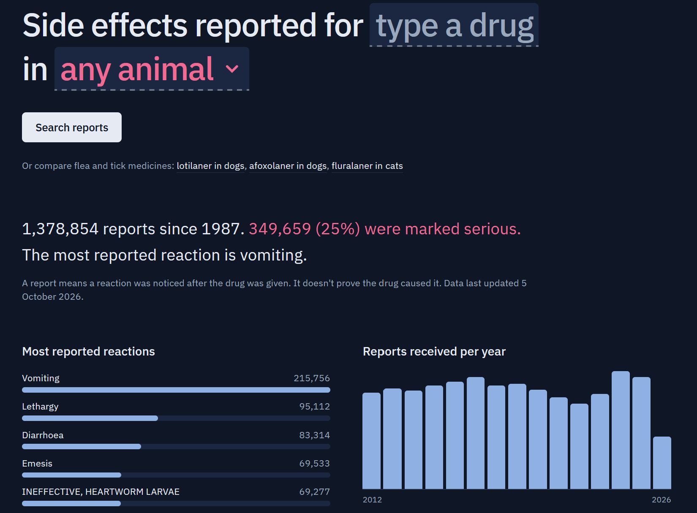
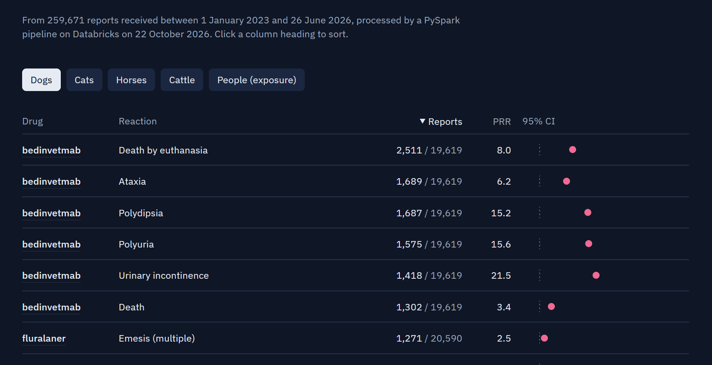
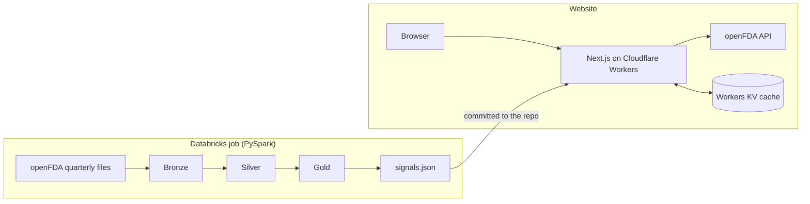

# Vet Safety Explorer

Explore side-effect reports for veterinary medicines, and see which reactions
are reported unusually often with a drug.

Live at **https://vetsafety.mohammadkalaf.com**

The data is the US FDA's public database of animal drug adverse events,
accessed through [openFDA](https://open.fda.gov/apis/animalandveterinary/event/).
Tracking these reports after a drug goes on sale is called
**pharmacovigilance**. The project has two parts:

- **Explorer** (`/`): pick an active ingredient and a species to see how many
  reports there are, what share were serious, the most reported reactions, the
  yearly trend and the latest individual reports. Data comes live from the
  openFDA API.
- **Signals** (`/signals`): a PySpark pipeline on Databricks processes about
  260,000 reports from 2023 onwards and flags drug and reaction pairs that are
  reported more often than expected, using the proportional reporting ratio
  (PRR).





## Does it find real signals?

In December 2024 the FDA
[wrote to vets](https://www.fda.gov/animal-veterinary/product-safety-information/dear-veterinarian-letter-notifying-veterinarians-about-adverse-events-reported-dogs-treated-librela)
about adverse events reported in dogs given Librela (bedinvetmab), a monthly
arthritis injection. The letter lists ataxia, seizures and other neurological
signs, paresis, recumbency, urinary incontinence, polyuria and polydipsia, and
death, including euthanasia.

The pipeline knows nothing about that letter, but the strongest-supported dog
signals for bedinvetmab include the same reactions (limb weakness is the plain
term for paresis):

| Reaction | Reports | PRR |
| --- | ---: | ---: |
| Urinary incontinence | 1,418 | 21.5 |
| Limb weakness | 1,209 | 19.9 |
| Polyuria | 1,575 | 15.6 |
| Polydipsia | 1,687 | 15.2 |
| Death by euthanasia | 2,511 | 8.0 |
| Ataxia | 1,689 | 6.2 |

From the snapshot run on 22 October 2026, out of 19,619 bedinvetmab reports
in dogs. This shows the method picks up a known problem, not that it would
have found it first: the data runs to mid-2026, and publicity after a warning
tends to bring in more reports (stimulated reporting).

## Architecture



The Explorer asks openFDA live, so it is always current. Signals need every
report at once, which the API can't provide, so they come from the bulk files
and are refreshed by re-running the job.

## Tech stack

| Part | Tool | Why |
| --- | --- | --- |
| Framework | Next.js 16 (App Router) | Pages and server code in one project |
| Language | TypeScript | Catches type mistakes before the code runs |
| Styling | Tailwind CSS 4 | Styles written next to the markup they affect |
| Tests | Vitest | Fast unit tests for the data logic |
| Data | openFDA REST API | Free, public, no login needed |
| Hosting | Cloudflare Workers via [OpenNext](https://opennext.js.org/cloudflare) | Runs the server code close to users; free tier |
| Cache | Workers KV | Stores cached openFDA results between requests |
| CI/CD | GitHub Actions | Checks every push, deploys `main` |
| Pipeline | PySpark on Databricks (Free Edition) | Bronze/silver/gold tables and signal detection |
| Pipeline tests | pytest with local Spark | Same transforms tested in CI without Databricks |

## Run it locally

You need [Node.js](https://nodejs.org) 22 or newer.

```bash
npm install      # download the libraries listed in package.json
npm run dev      # start a local server at http://localhost:3000
```

Other commands:

```bash
npm test             # run the unit tests once
npm run test:watch   # re-run tests every time you save a file
npm run lint         # check code style
npm run typecheck    # check TypeScript types
npm run build        # build the production version
```

An openFDA API key is optional. To use one, copy `.env.example` to
`.env.local` and fill it in.

## How it works

1. **The search lives in the URL.** Searching for lotilaner in dogs goes to
   `/?ingredient=lotilaner&species=Dog`, so every search can be bookmarked or
   shared. `src/lib/filters.ts` reads and cleans these values. Searching with
   both blanks empty shows every report; a fresh visit makes no requests.
2. **The server asks openFDA five questions at once:** the total number of
   reports, the number of serious ones, the top reactions, reports per day,
   and the 10 newest reports. They run in parallel with `Promise.all`.
   See `getSafetyOverview` in `src/lib/openfda/client.ts`.
3. **The answers are tidied up** by pure functions in
   `src/lib/openfda/transform.ts`, e.g. adding daily counts up into years.
4. **Results are cached for a few hours** (`src/lib/openfda/data.ts`), because
   openFDA updates weekly and has a daily request limit.
5. **The page streams.** The form appears straight away and the results stream
   in behind a loading skeleton (`<Suspense>` in `src/app/page.tsx`).
6. **The Signals page reads a JSON file** written by the pipeline
   (`src/data/signals.json`), so it needs no database and no requests at run
   time. Sorting the table happens in the browser.
7. **Light, dark or system theme.** Colours are CSS variables using
   `light-dark()`, so they follow the system setting unless a choice is saved.
   A one-line script in `<head>` applies a saved choice before the first paint,
   so the page never flashes the wrong theme.

```
pipeline/                 PySpark pipeline (see "Data pipeline" below)
docs/screenshots/         images used in this README
.github/workflows/ci.yml  checks and deploy
wrangler.jsonc            Cloudflare Worker config
open-next.config.ts       Next.js to Workers adapter config
scripts/
  update-ingredients.mjs  refreshes the drug suggestion snapshot
src/
  app/
    page.tsx            the Explorer page
    signals/page.tsx    the Signals page
    layout.tsx          wraps every page: header, footer, theme script
    globals.css         colour tokens and base styles
  components/           the pieces of the page (form, charts, tables, theme toggle)
  data/
    ingredient-counts.json  snapshot of openFDA's most-reported ingredients
    signals.json            flagged signals exported by the pipeline
  lib/
    filters.ts          reading the search from the URL
    ingredients.ts      cleaning ingredient names for suggestions
    signals.ts          species tabs and sorting for the Signals page
    theme.ts            theme names and the no-flash script
    openfda/
      types.ts          the shape of openFDA's data
      query.ts          building openFDA request URLs safely
      client.ts         fetching from openFDA
      transform.ts      reshaping raw data for the UI
      data.ts           cached version used by the page
    *.test.ts           unit tests, next to the code they test
```

## Design decisions

- **Network code takes a `fetchFn` argument.** Tests pass in a fake `fetch`,
  so they run in under a second and never depend on openFDA being up.
- **openFDA's "404 Not Found" is not treated as an error.** openFDA uses it to
  mean "no matches", which is a normal result for a search.
- **User input is sanitised** before going into an openFDA query, so typing
  quotes or colons can't change the meaning of the search.
- **Drug suggestions come from a snapshot**, not a live request, so loading the
  page never calls openFDA. openFDA's raw names mix in doses, salts and
  combinations ("Ivermectin/Pyrantel Pamoate Chewable 272Mcg/652Mg"), so
  `src/lib/ingredients.ts` reduces them to base names before ranking. Refresh
  the snapshot with `node scripts/update-ingredients.mjs`.
- **Charts are plain HTML and CSS** rather than a charting library: fewer
  dependencies, server-rendered, and easy to read.
- **The "partial year" note uses openFDA's last-updated date**, not the
  server clock, so it follows the data rather than the calendar.
- **Cache Components is switched off.** On Cloudflare Workers its staged
  rendering hangs requests, a known adapter bug
  ([opennextjs-cloudflare#1318](https://github.com/opennextjs/opennextjs-cloudflare/pull/1318)).
  Caching uses `unstable_cache` instead, stored in Workers KV.
- **Signals use clinical signs only.** VeDDRA terms also cover product
  complaints ("Tubes, Leaking"), medication errors, lack of efficacy and
  admin codes. `pipeline/vetsafety/names.py` sorts every term into one of these
  categories, and only clinical ones go into the PRR, as in standard
  pharmacovigilance. Reports with no species are dropped from the export, since
  nearly all of them are product complaints.
- **Signals are sorted by number of reports by default**, not by PRR. When a
  reaction almost never appears with other drugs, the PRR divides by nearly
  zero, so 3 reports can score 5,000. Sorting by reports puts the
  best-supported signals first, and the pipeline keeps each species' top 100
  in the same order. Any column can be clicked to sort by it instead.

## Deployment

Every push and pull request runs lint, type check, tests and a build in GitHub
Actions. When those pass on `main`, the app is built for Cloudflare Workers
and deployed automatically.

To try the Workers build locally (Linux, macOS or WSL):

```bash
npm run preview
```

## Data pipeline

`pipeline/` is a PySpark pipeline packaged as a Python wheel and run as a
five-task Databricks Job on serverless compute, defined as code in
`pipeline/databricks.yml`:

```
setup → bronze → silver → gold → export
```

| Layer | Tables | What happens |
| --- | --- | --- |
| Bronze | `bronze_reports` | openFDA's quarterly JSON files read with an explicit schema; source file and load time kept |
| Silver | `silver_reports`, `silver_report_ingredients`, `silver_report_reactions`, `silver_quality_checks` | Duplicates resolved (newest file wins), dates typed, ingredient and reaction names cleaned, data-quality checks run |
| Gold | `gold_monthly_counts`, `gold_ingredient_features`, `gold_signals` | Monthly counts, a per-drug feature table (volume, serious share, 3-month trend) and disproportionality signals |

**Signals** use the proportional reporting ratio (PRR), stratified by species,
with a 95% confidence interval and Yates-corrected chi-square. A pair is
flagged at 3+ cases, PRR ≥ 2 and chi-square ≥ 4 (Evans et al., 2001). The
`export` task writes flagged signals to `signals.json`, which the site's
`/signals` page reads.

**Data quality.** Silver stops the job if more than a set share of reports
have no ID, an unparseable date, no usable ingredient or no reaction. Results
are saved to `silver_quality_checks` first, so a failed run still shows why.

**Name cleaning** is the same logic as the site's `src/lib/ingredients.ts`,
written with Spark's built-in functions rather than a Python UDF, so it runs
in the JVM. Both test suites share the same test cases.

### Running it

1. Deploy the job: `cd pipeline && databricks bundle deploy`. This builds the
   wheel (needs Python locally) and uploads it with the job definition.
2. Run it: `databricks bundle run vetsafety_pipeline`. The `setup` task creates
   the schema and volumes, then downloads from openFDA.
3. Databricks Free Edition blocks most outbound internet. If the download is
   blocked, `setup` fails with a message saying so. Download locally from the
   `pipeline` folder with `python -m vetsafety.download --since 2023q1`, upload
   `raw/*.json` to the `workspace.vetsafety.raw` volume, and run the job again.
4. Copy `/Volumes/workspace/vetsafety/exports/signals.json` to
   `src/data/signals.json` and commit it.

The job ships as a wheel rather than loose `.py` files because importing
modules straight from workspace storage failed on Databricks with
`OSError: [Errno 5]`. A wheel is installed before the task starts, so nothing
is read from workspace storage at run time.

Tests run locally and in CI without Databricks:

```bash
cd pipeline
pip install -r requirements-dev.txt   # needs Java 17+
python -m pytest tests
```

## Limitations

- A report means a reaction was noticed after a drug was given. It does not
  prove the drug caused it, and report counts depend on how widely a drug is
  used, so raw counts can't fairly compare two drugs.
- The data is mostly from the US and is unverified.
- Searches match the active ingredient, not brand names.
- PRR compares reporting rates, not risk. A high PRR can come from how a drug is
  used (e.g. in already-sick animals) rather than the drug itself.
- Combination products show up once per ingredient. An ear treatment with three
  active ingredients produces three near-identical signals.
- openFDA truncates some long ingredient names (e.g. "trenbolone acet"), so a
  few appear cut off.

## Data

Data from openFDA, provided by the US Food and Drug Administration. Not for
clinical decisions.
